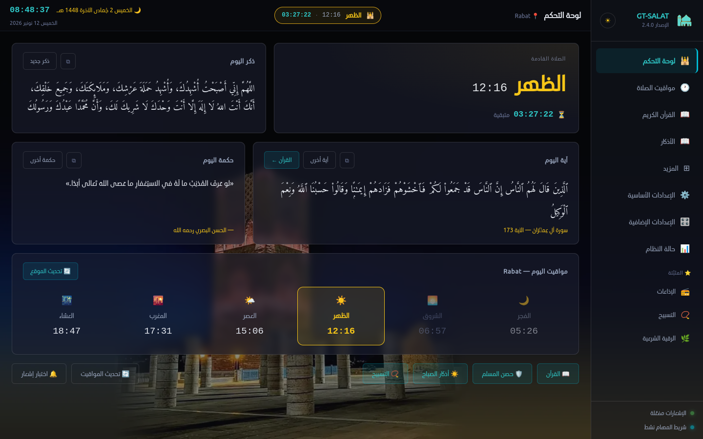

<div dir="rtl">

# GT-SALAT — الجيل الجديد من GT-salat-dikr

**تطبيق إسلامي متكامل لمواقيت الصلاة والأذكار والقرآن على لينكس**

[](LICENSE)
[]()
[]()

---

## نبذة عن المشروع

**GT-SALAT** هو الجيل الجديد من مشروع
[GT-salat-dikr](https://github.com/SalehGNUTUX/GT-salat-dikr)
بقلم **SalehGNUTUX**، مُعاد بناؤه من الصفر كتطبيق سطح مكتب كامل يعمل
بتقنيات الويب (React + TypeScript + Electron) مع الحفاظ على جميع ميزات
النسخة الأصلية وإضافة واجهة رسومية تفاعلية حديثة.

> النسخة الأصلية كانت أداة طرفية (Bash/Python). هذه النسخة تستهدف مستخدمي
> الواجهة الرسومية، مع بقاء التكامل مع الطرفية خياراً اختيارياً من الإعدادات.

> **النسخة 2.0** أضافت قسم «المزيد» بثلاثة عشر قسماً من المحتوى الإسلامي (القرآن والتفسير
> وحصن المسلم والأذكار والأحاديث والأدعية والإذاعات…)، وصفحة «الإعدادات الإضافية».
> **كل المحتوى مُضمَّن في الحزمة ويعمل دون إنترنت.** انظر [CHANGELOG.md](CHANGELOG.md).

---

## المزايا

### الصلاة والمواقيت
- حساب مواقيت الصلاة الخمس بـ 22 طريقة حسابية (ISNA، أم القرى، MWL، الجزائر، المغرب…)
- ضبط تلقائي لطريقة الحساب بناءً على البلد المكتشف جغرافياً
- **اختيار المدينة دون إنترنت**: قاعدة مُضمَّنة فيها 82 مدينة في 51 دولة، ببحثٍ عربيٍّ مطبَّع
- مصدر مزدوج: AlAdhan API أولاً ← حساب محلي احتياطي (مكتبة adhan) يعمل دون إنترنت
- جدول المواقيت بثلاثة أوضاع: **أسبوعي — نصف شهري — شهري**، يبدأ من تاريخ اليوم دائماً
- عداد تنازلي حي لوقت الصلاة القادمة
- التاريخ الهجري (من API) بجانب التاريخ الميلادي بأرقام لاتينية (0-9)

### الإشعارات والصوت
- إشعار نظام قبل الصلاة بفترة قابلة للضبط (1–60 دقيقة)
- إشعار عند دخول وقت الصلاة مع تشغيل الأذان
- **أذان مخصص**: رفع ملف صوتي خاص (OGG / MP3 / WAV) يُستخدم بدلاً من الأذان الافتراضي
- نوعان من الأذان الافتراضي: الكامل والقصير
- **دعاء بعد الأذان**: يُشغَّل تلقائياً فور انتهاء الأذان
- **أذكار وأدعية بعد الصلاة**: تُشغَّل بعد فترة قابلة للضبط من دخول الوقت
- تنبيه الاقتراب (صوت منفصل)
- نغمة تذكير الأذكار على فترات منتظمة
- وضع "لا إزعاج" بزر واحد

### الأذكار
- قاعدة بيانات الأذكار الكاملة (azkar.txt)
- بحث فوري في النصوص
- عداد لكل ذكر محفوظ محلياً
- عرض ذكر عشوائي في لوحة التحكم

### المحتوى الإسلامي (قسم «المزيد»)
- **القرآن الكريم**: 114 سورة بالرسم العثماني، بحث شامل في 6236 آية بتطبيع عربي، إشارات مرجعية، متابعة موضع القراءة
- **التفسير الميسّر**: تفسير كل آية، يظهر تحتها بتوگل
- **حصن المسلم**: 132 باباً و267 ذكراً ببحث وعدّاد تكرار لكل ذكر
- **أذكار الصباح والمساء**: جلسة بعدّاد وشريط تقدّم يُحفظ ليومه
- **التسبيح**: مِسبحة بهدف ومجموع تراكمي
- **الأربعون النووية ورياض الصالحين** (90 حديثاً) · **الأدعية المأثورة** (28) · **أسماء الله الحسنى** (100) · **حِكَم ومواعظ** (32)
- **أحداث تاريخية** (59 حدثاً) · **الإذاعات القرآنية** (36 إذاعة مباشرة) · **إمساكية رمضان**
- المحتوى مشترك حرفياً مع [نسخة الهاتف](https://github.com/SalehGNUTUX/GT-SALAT-PHONE)

### التكامل مع الطرفية
- عند فتح أي طرفية جديدة يظهر تلقائياً:
  - ترويسة "بسم الله الرحمن الرحيم — GT-SALAT" بحدود مزدوجة
  - ذكر عشوائي من قاعدة الأذكار
  - اسم الصلاة القادمة ووقتها والوقت المتبقي (محسوب لحظياً)
- يدعم bash و zsh و fish
- يُحدَّث السكربت تلقائياً عند كل تشغيل للتطبيق
- يمكن تفعيله/إلغاؤه في أي وقت من الإعدادات

### التكامل مع النظام
- **التحديث من داخل التطبيق**: يُنزَّل الإصدار الجديد ويُثبَّت من مكانه — صورة AppImage تستبدل
  نفسها، وحزمة DEB/RPM تُسلَّم إلى مدير حزم النظام. وتُتحقَّق بصمة الحزمة (SHA256) قبل تثبيتها،
  والتنزيل يُستأنَف بعد انقطاع الشبكة
- أيقونة شريط المهام مع قائمة سياق — **النقر عليها يُظهر النافذة أو يخفيها**
- تصغير إلى شريط المهام بدلاً من الإغلاق
- بدء تشغيل تلقائي مع الجهاز
- فتح مجلد جداول المواقيت مباشرة من الإعدادات

### إعداد أولي وترحيل
- معالج إعداد خطوة بخطوة (5 خطوات)
- اكتشاف تلقائي للموقع الجغرافي مع اقتراح طريقة الحساب المناسبة
- استيراد إعدادات GT-salat-dikr القديمة تلقائياً

### الإعدادات الإضافية (صفحة مستقلة)
- **مذهب حساب العصر**: الجمهور أو الحنفي
- **مستوى صوت الأذان** وأزرار تجربة لكل صوت
- **نمط تنبيه لكل صلاة على حدة**: أذان كامل، أم رنّة قصيرة، أم إشعار صامت
- **التذكيرات اليومية**: أذكار الصباح والمساء بساعة مختارة، والأيام البيض (13/14/15 هجرياً)
- **نظام 12/24 ساعة** · **إزاحة التاريخ الهجري ±3 أيام** (حساب أم القرى)
- **أسماء الأشهر الميلادية**: قياسي أو مغاربي (يوليوز/غشت) أو شامي (تمّوز/آب) أو تلقائي حسب بلدك
- **العمل دون إنترنت كلياً**: تعطيل تحديث المواقيت عبر الإنترنت والاكتفاء بالحساب المحلي

### جديد في 2.3
- **التطبيق يتبع توقيت النظام**: أُصلح تقدّم الساعة والأذان ساعةً في المغرب بعد عودته إلى GMT+0 (بيانات المناطق
  المضمَّنة في Electron قديمة)، مع خيار «توقيت التطبيق» لتصحيحه يدويّاً في «التقويم والتواريخ».
- **خلفيّات المساجد** للوحة التحكّم: ثماني صورٍ أو صورةٌ من حاسوبك، بثلاث درجات ظهور، ونافذة الأذان تتبعها.
- **السمة الزجاجيّة**: لوحاتٌ شفّافةٌ فوق الخلفيّة في كلّ الأقسام، وشدّة تغبيشٍ من 0 إلى 100.
- **الأذان المغربيّ** كاملاً وقصيراً، والكامل هو الأذان الافتراضيّ.
- **مؤقّت إيقافٍ** للإذاعة والتلاوة، و**إعادة اتّصالٍ تلقائيّة** بالبثّ عند انقطاع الشبكة.
- **372 مدينةً وبلدةً مغربيّة** لاختيار الموقع دون إنترنت (GeoNames + OpenStreetMap، ODbL).
- لا أذان خارج وقته: إن فات الموعد والحاسوب نائم يُعلَن دخول الوقت بإشعارٍ صامت.

### الواجهة
- خطوط Ubuntu Arabic + Amiri Quran مضمّنة (بلا اتصال إنترنت)
- وضع مظلم وفاتح، و**لون مميّز مخصّص** ينتقل إلى كل الصفحات
- واجهة عربية RTL كاملة
- لوحة تحكم فيها آية اليوم وحكمة اليوم وحدث اليوم وبطاقة رمضان
- لوحة الحالة لمتابعة سجل الإشعارات وصحة المكونات

---

## متطلبات النظام

| المتطلب | الحد الأدنى |
|--------|------------|
| نظام التشغيل | Linux (x86_64) |
| معالج | أي معالج حديث |
| ذاكرة | 256 ميغابايت |
| مكتبات النظام | libnotify، GTK3، ALSA |
| مشغّل صوت | mpv أو ffplay أو cvlc أو paplay أو sox (أحدها كافٍ) |

> **ملاحظة الصوت:** يكتشف التطبيق المشغّل المتاح تلقائياً. يُنصح بتثبيت **mpv** للحصول على أفضل توافق:
> ```bash
> sudo apt install mpv        # Debian/Ubuntu
> sudo dnf install mpv        # Fedora
> sudo pacman -S mpv          # Arch
> ```

---



<sub>لوحة التحكم — الصلاة القادمة بعدّادٍ حيّ، وآية اليوم، وحكمة اليوم، ومواقيت اليوم.
[لقطاتٌ أخرى على موقع المشروع ←](https://salehgnutux.github.io/GT-SALAT/#screenshots)</sub>

---

## 📱 نسخة الهاتف

GT-SALAT متوفّر لأندرويد بنفس المحتوى، مع الأذان في وقته والقبلة والودجت، وبنكهة حرّة بلا خدمات Google:
**[salehgnutux.github.io/GT-SALAT-PHONE](https://salehgnutux.github.io/GT-SALAT-PHONE/)** — [المستودع](https://github.com/SalehGNUTUX/GT-SALAT-PHONE) ·
أحدث إصدار **[v2.1](https://github.com/SalehGNUTUX/GT-SALAT-PHONE/releases/tag/v2.1)** (7 نونبر 2026)

---

## التحميل (الإصدار 2.3.0)

### 🖥️ الحواسيب (x86_64)

| الصيغة | التوزيعات | الملف | الحجم |
|--------|-----------|-------|-------|
| **AppImage** | جميع التوزيعات | [GT-SALAT-2.3.0-x86_64.AppImage](https://github.com/SalehGNUTUX/GT-SALAT/releases/download/GT-SALAT-2.3.0/GT-SALAT-2.3.0-x86_64.AppImage) | 134 MB |
| **DEB** | Debian · Ubuntu · Mint | [GT-SALAT_2.3.0_amd64.deb](https://github.com/SalehGNUTUX/GT-SALAT/releases/download/GT-SALAT-2.3.0/GT-SALAT_2.3.0_amd64.deb) | 102 MB |
| **RPM** | Fedora · RHEL · Rocky | [gt-salat-2.3.0-1.x86_64.rpm](https://github.com/SalehGNUTUX/GT-SALAT/releases/download/GT-SALAT-2.3.0/gt-salat-2.3.0-1.x86_64.rpm) | 102 MB |

### 🍓 ARM (راسبيري باي · حواسيب ARM · خوادم aarch64)

| المعمارية | الصيغة | الملف | الحجم |
|-----------|--------|-------|-------|
| **aarch64 / arm64** | AppImage | [GT-SALAT-2.3.0-arm64.AppImage](https://github.com/SalehGNUTUX/GT-SALAT/releases/download/GT-SALAT-2.3.0/GT-SALAT-2.3.0-arm64.AppImage) | 134 MB |
| **aarch64 / arm64** | DEB | [GT-SALAT_2.3.0_arm64.deb](https://github.com/SalehGNUTUX/GT-SALAT/releases/download/GT-SALAT-2.3.0/GT-SALAT_2.3.0_arm64.deb) | 98 MB |
| **armv7l / armhf** (32-بت) | AppImage | [GT-SALAT-2.3.0-armv7l.AppImage](https://github.com/SalehGNUTUX/GT-SALAT/releases/download/GT-SALAT-2.3.0/GT-SALAT-2.3.0-armv7l.AppImage) | 123 MB |
| **armv7l / armhf** (32-بت) | DEB | [GT-SALAT_2.3.0_armv7l.deb](https://github.com/SalehGNUTUX/GT-SALAT/releases/download/GT-SALAT-2.3.0/GT-SALAT_2.3.0_armv7l.deb) | 96 MB |

> لمعرفة معمارية جهازك: `uname -m` — فإن كانت `aarch64` فحزم arm64، وإن كانت `armv7l` فحزم armv7l.
>
> **لا تتوفّر حزمة x86 32-بت (i386)**: مشروع Electron أوقف بناءها للينكس منذ الإصدار 4 (2018)،
> فلا سبيل إليها إلا بمحرّكٍ قديمٍ لا يتلقّى تحديثاتٍ أمنية. وحزم RPM لـARM غير مبنيّةٍ بعد
> (تُبنى عبر `alien` من DEB على الحاسوب)، وبديلها AppImage — يعمل على كلّ التوزيعات بلا تثبيت.

للتحقّق من سلامة التنزيل (sha256):

```
3a3c9a663283083fa023dc3e6948b1dbf31d75bc51ede23693319a785a7f67d7  GT-SALAT-2.3.0-x86_64.AppImage
1df11a1ec91dec3b6144c45c4e9725733e179ae0bdc05e5ef61bdcd228d04b1d  GT-SALAT_2.3.0_amd64.deb
732d4346531b44e4a67dfb2c2483b37ff63475e35b514793010ad512d5f73af6  gt-salat-2.3.0-1.x86_64.rpm
6135ce83bd1940a1efc37e847dec642aeb9a8017b553d29f5478c936d5181386  GT-SALAT-2.3.0-arm64.AppImage
a1d143fb5cea9eb508d2f33ad41eef4b7a7bd78888639a97c8891b47ea5aa5a0  GT-SALAT_2.3.0_arm64.deb
c2e676f81e10a3a40c0ecd1bf92204e4a49800e324fed1c1541a51870e36a066  GT-SALAT-2.3.0-armv7l.AppImage
7b5bdc708b8fa61ba98244da31cc65e24a59b2dd17653cca26a0f2353f527618  GT-SALAT_2.3.0_armv7l.deb
```

---

## التثبيت من الحزم الجاهزة

### Debian / Ubuntu / Linux Mint

```bash
sudo dpkg -i GT-SALAT_*.deb
sudo apt-get install -f   # لحل الاعتماديات إن وُجدت
```

### Fedora / RHEL / Rocky

```bash
sudo rpm -i GT-SALAT-*.rpm
```

### AppImage (جميع التوزيعات)

```bash
chmod +x GT-SALAT_*.AppImage
./GT-SALAT_*.AppImage
```

---

## البناء من المصدر

### 1. تثبيت اعتماديات البناء

```bash
./scripts/install-deps-host.sh
```

يدعم السكربت: Ubuntu/Debian/Mint، Fedora/RHEL/Rocky، Arch/Manjaro، openSUSE.

### 2. بناء جميع الحزم

```bash
./scripts/build-all.sh
```

أو بناء حزمة محددة:

```bash
./scripts/build-all.sh appimage   # AppImage فقط
./scripts/build-all.sh deb        # DEB فقط
./scripts/build-all.sh rpm        # RPM فقط
```

يبني السكربت كل هدف على حدة ويُبلّغ عن نتيجة كل منها دون إيقاف البناء عند فشل أحدها.  
الحزم الناتجة في مجلد `release/`.

---

## وضع التطوير

```bash
./scripts/dev.sh
# أو
npm run dev
```

يشغّل Vite dev server + Electron مع hot-reload للواجهة.

```bash
npm run typecheck   # فحص TypeScript بدون بناء
```

---

## بنية المشروع

```
GT-SALAT/
├── electron/           # العملية الرئيسية (Node.js / Electron)
│   ├── main.ts         # نقطة الدخول، دورة حياة التطبيق
│   ├── preload.ts      # جسر IPC الآمن (contextBridge)
│   ├── settings.ts     # إدارة الإعدادات (electron-store)
│   ├── prayer.ts       # حساب المواقيت + واجهة AlAdhan API
│   ├── dhikr.ts        # تحليل قاعدة الأذكار
│   ├── audio.ts        # تشغيل الصوت (mpv/ffplay/cvlc/paplay/sox)
│   ├── notifier.ts     # الإشعارات وسجلها
│   ├── scheduler.ts    # مجدول المواقيت (فحص كل 30 ثانية)
│   ├── tray.ts         # أيقونة شريط المهام
│   ├── shell-hook.ts   # حقن كود الطرفية (bashrc/zshrc/fish)
│   ├── autostart.ts    # ملف .desktop للبدء التلقائي
│   └── ipc.ts          # تسجيل جميع معالجات IPC (~35 معالج)
├── src/                # واجهة المستخدم (React + TypeScript)
│   ├── pages/          # الصفحات الخمس
│   ├── components/     # مكونات مشتركة
│   ├── hooks/          # React hooks مخصصة
│   ├── styles/         # ثيم CSS وخطوط
│   └── assets/         # خطوط + أيقونات
├── resources/          # ملفات وقت التشغيل
│   ├── azkar.txt       # قاعدة الأذكار
│   ├── audio/          # ملفات الصوت (ogg)
│   └── icons/          # أيقونات التطبيق
└── scripts/            # سكربتات البناء والتطوير
```

---

## الفرق بين GT-SALAT و GT-salat-dikr

| الجانب | GT-salat-dikr (الأصل) | GT-SALAT (هذه النسخة) |
|--------|----------------------|----------------------|
| الواجهة | طرفية (Bash) | رسومية كاملة (Electron + React) |
| التكامل مع الطرفية | افتراضي | اختياري من الإعدادات |
| التثبيت | bash script | AppImage / DEB / RPM |
| الخطوط | خطوط النظام | Ubuntu Arabic + Amiri Quran مضمّنة |
| الإعداد | متغيرات بيئة / CLI | معالج رسومي 5 خطوات |
| الأذان | ملف صوتي ثابت | افتراضي (كامل/قصير) + مخصص |
| المواقيت | حساب محلي | API + حساب محلي احتياطي |
| الحالة | النسخة الأصلية | الجيل الجديد |

---

## الترخيص

هذا المشروع مرخص بموجب
[رخصة GNU العامة الإصدار 3](LICENSE) (GPL-3.0).

---

## الفضل والشكر

- **SalehGNUTUX** — مؤلف المشروع الأصلي GT-salat-dikr الذي شكّل الأساس لهذا العمل
- **AlAdhan.com** — واجهة برمجية مجانية لمواقيت الصلاة
- **مشروع Adhan** (Batoul Apps) — مكتبة حساب المواقيت المحلية
- **مشروع Electron** — إطار العمل لتطبيقات سطح المكتب

</div>
